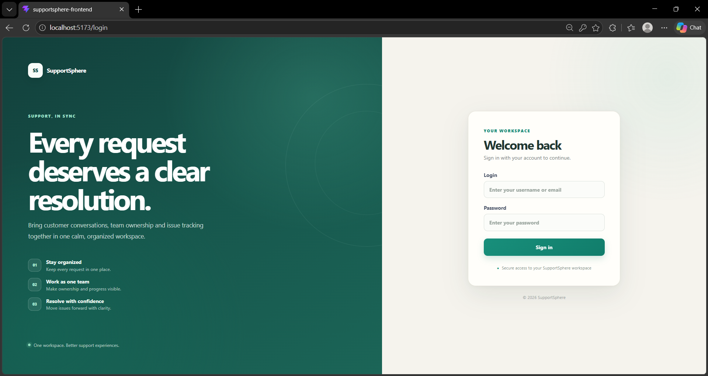
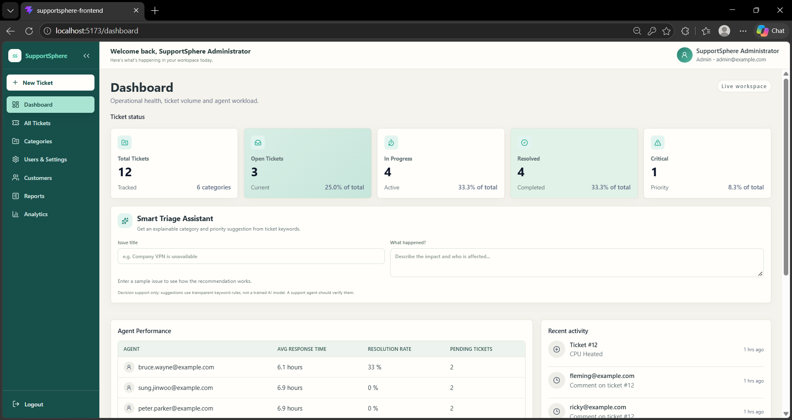
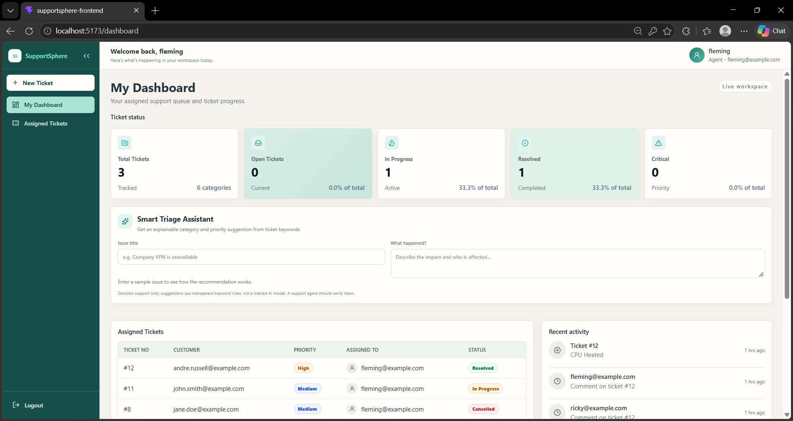
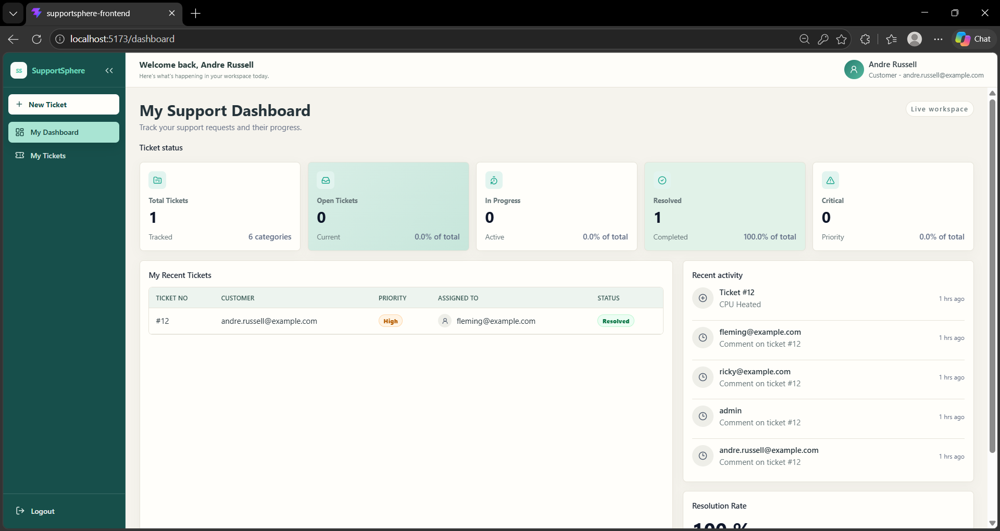

# SupportSphere – Smart IT Helpdesk & Support Management System

SupportSphere is a full-stack IT helpdesk and support management application designed to streamline support requests, ticket assignment, communication, and issue resolution through a centralized platform.

It provides separate experiences for administrators, support agents, and customers, with role-based access control and an organized ticket management workflow.

## Project Overview

Support requests are often managed through scattered emails, messages, and manual processes. This makes it difficult to track issues, assign responsibilities, monitor progress, and maintain accountability.

SupportSphere addresses this problem by providing a centralized support management platform where customers can raise tickets, agents can manage and resolve assigned issues, and administrators can monitor the overall support operation.

## Key Features

### 1. Authentication and Role-Based Access Control
- User authentication using Django REST Framework Token Authentication.
- Separate access for Admin, Agent, and Customer roles.
- Role-based navigation and protected application routes.
- Backend permission checks for protected operations.

### 2. Ticket Management
- Create and submit support tickets.
- Assign tickets to support agents.
- Track ticket status and priority.
- Search and filter tickets.
- View individual ticket details.
- Manage ticket progress through its lifecycle.

### 3. Customer Management
- View registered customers.
- Search customers by name or email.
- Add new customers.
- Edit customer information.
- Activate and deactivate customer accounts.
- Display customer ticket counts.

### 4. Agent Management
- Manage support agents.
- Assign tickets to agents.
- Provide agents with access to their assigned support work.
- Restrict administrative operations according to role permissions.

### 5. Comments and Ticket History
- Add comments to support tickets.
- Maintain communication between customers and support agents.
- Track ticket status changes through a history timeline.

### 6. Dashboard and Analytics
- Display ticket statistics.
- Monitor ticket statuses and priorities.
- View recent support activity.
- Monitor agent workload.

### 7. Smart Triage Assistant – Experimental
A partially implemented feature intended to assist with ticket categorization and prioritization.

The planned functionality uses keyword-based rules to suggest ticket categories and priorities. This feature is experimental and should not be considered a fully completed AI or machine-learning system.

## User Roles

| Role | Permissions |
|---|---|
| Admin | Manage users, customers, agents, categories, tickets, assignments, and dashboard information |
| Agent | View assigned tickets, update ticket status, communicate through comments, and resolve support issues |
| Customer | Create support tickets, view personal tickets, track progress, and communicate through comments |

Backend permission checks enforce access restrictions in addition to frontend route protection.

## Technology Stack

### Frontend
- React 19.2.7
- JavaScript (ES Modules)
- Vite 8.1.0
- React Router DOM 7.18.0
- Lucide React
- CSS

### Backend
- Python 3.14
- Django 6.0.6
- Django REST Framework 3.17.1
- Django CORS Headers 4.9.0
- DRF Token Authentication

### Database
- PostgreSQL
- Psycopg 3.x

### Development and Version Control
- Git
- GitHub
- GitHub Actions
- VS Code

## System Architecture

```text
              User Browser
                   |
                   v
          React + Vite Frontend
                   |
             HTTP / JSON
          Token Authentication
                   |
                   v
          Django REST Framework
                   |
          ---------------------
          |                   |
          v                   v
      Users App           Tickets App
          |                   |
          ---------------------
                   |
                   v
             PostgreSQL
```

The React frontend handles the user interface and client-side interactions.

The Django REST Framework backend handles authentication, authorization, validation, business logic, and database operations.

PostgreSQL stores application data.

## Project Structure

```text
SupportSphere/
│
├── supportsphere-frontend/
│   ├── public/
│   ├── src/
│   │   ├── components/
│   │   ├── pages/
│   │   ├── services/
│   │   └── ...
│   ├── package.json
│   └── vite.config.js
│
├── supportsphere_api/
│   ├── settings.py
│   ├── urls.py
│   └── ...
│
├── tickets/
│   ├── models.py
│   ├── serializers.py
│   ├── views.py
│   └── ...
│
├── users/
│   ├── models.py
│   ├── serializers.py
│   ├── permissions.py
│   ├── views.py
│   └── ...
│
├── .env.example
├── .gitignore
├── manage.py
├── requirements.txt
└── README.md
```

## Requirements

Install the following before running the application:

- Python 3.14
- Node.js compatible with Vite 8
- npm
- PostgreSQL
- Git

## Installation and Setup

### 1. Clone the Repository

```powershell
git clone YOUR_GITHUB_REPOSITORY_URL
cd SupportSphere
```


### 2. Backend Setup

Create and activate a virtual environment:

```powershell
py -m venv .venv
.\.venv\Scripts\Activate.ps1
```

Install Python dependencies:

```powershell
pip install -r requirements.txt
```

Create your environment configuration:

```powershell
Copy-Item .env.example .env
```

### 3. PostgreSQL Configuration

Create a PostgreSQL database and user.

Example SQL:

```sql
CREATE USER supportsphere_user
WITH PASSWORD 'your-local-password';

CREATE DATABASE supportsphere
OWNER supportsphere_user;
```

Update your local `.env` file:

```env
DJANGO_SECRET_KEY=your-own-secret-key
DJANGO_DEBUG=True
DJANGO_ALLOWED_HOSTS=localhost,127.0.0.1,testserver
CORS_ALLOWED_ORIGINS=http://localhost:5173,http://127.0.0.1:5173

DB_ENGINE=postgres

POSTGRES_DB=supportsphere
POSTGRES_USER=supportsphere_user
POSTGRES_PASSWORD=your-local-password
POSTGRES_HOST=127.0.0.1
POSTGRES_PORT=5432
```

### 4. Apply Database Migrations

```powershell
python manage.py migrate
```

### 5. Load Demo Data

```powershell
python manage.py seed_demo_data
```

This command creates sample users, categories, agents, customers, and tickets for local testing.

### 6. Start the Backend Server

```powershell
python manage.py runserver
```

Backend:

http://127.0.0.1:8000/

API:

http://127.0.0.1:8000/api/

### 7. Frontend Setup

Open a second terminal:

```powershell
cd supportsphere-frontend
npm install
```

Start the React development server:

```powershell
npm run dev
```

Frontend:

http://localhost:5173/

## API Endpoints

The following are the main application API endpoints.

| Method | Endpoint | Purpose |
|---|---|---|
| POST | `/api/auth/login/` | User authentication |
| POST | `/api/auth/register/` | User registration |
| GET/POST | `/api/users/` | User management |
| GET/POST | `/api/customers/` | Customer listing and creation |
| GET/PATCH | `/api/customers/{id}/` | Retrieve and update customers |
| GET/POST | `/api/categories/` | Category management |
| GET/POST | `/api/tickets/` | Ticket listing and creation |
| GET/PATCH/DELETE | `/api/tickets/{id}/` | Ticket operations |
| GET | `/api/tickets/dashboard/` | Dashboard statistics |
| GET | `/api/tickets/{id}/history/` | Ticket history |
| GET/POST | `/api/tickets/{id}/comments/` | Ticket comments |

Authenticated requests use the following header:

```http
Authorization: Token YOUR_AUTH_TOKEN
```

Access to individual endpoints depends on the user's role and backend permissions.

## Demo Data

Use the demo data command to populate the application:

```powershell
python manage.py seed_demo_data
```

The seed script creates sample accounts for Admin, Agent, and Customer roles.

Demo credentials are intended only for local demonstration. Change or replace them before any public deployment.

## Testing and Quality Checks

### Backend

```powershell
python manage.py check
python manage.py test
```

### Frontend

```powershell
cd supportsphere-frontend
npm run lint
npm run build
```

### Continuous Integration

The repository includes a GitHub Actions workflow under `.github/workflows/ci.yml`.

It automatically performs:

- Django backend checks and tests.
- Frontend dependency installation.
- ESLint validation.
- React production build verification.

The workflow runs on pushes to the main and master branches and on pull requests.

## Screenshots

### Login Page


### Admin Dashboard


### Agent Dashboard


### Customer Dashboard


## Development Highlights

The project demonstrates practical full-stack development concepts, including:

1. Building a React-based frontend with reusable components.
2. Integrating React with Django REST APIs.
3. Implementing token-based authentication.
4. Enforcing role-based permissions on the backend.
5. Designing and implementing customer management APIs.
6. Managing ticket creation, assignment, status updates, and comments.
7. Integrating PostgreSQL with Django.
8. Implementing search, filtering, and dashboard statistics.
9. Using GitHub Actions for automated quality checks.

## Future Enhancements

- Complete the Smart Triage Assistant.
- Integrate a trained machine-learning model for ticket classification.
- Add email notifications for ticket updates.
- Introduce advanced analytics and reporting.
- Deploy the application with production-grade security and monitoring.


## Project Status

**Development and local testing completed.**

The main authentication, role-based access, ticket management, customer management, and dashboard workflows have been tested locally.

Production deployment and final public release preparation are separate steps.

---

**SupportSphere – Smart IT Helpdesk & Support Management System**